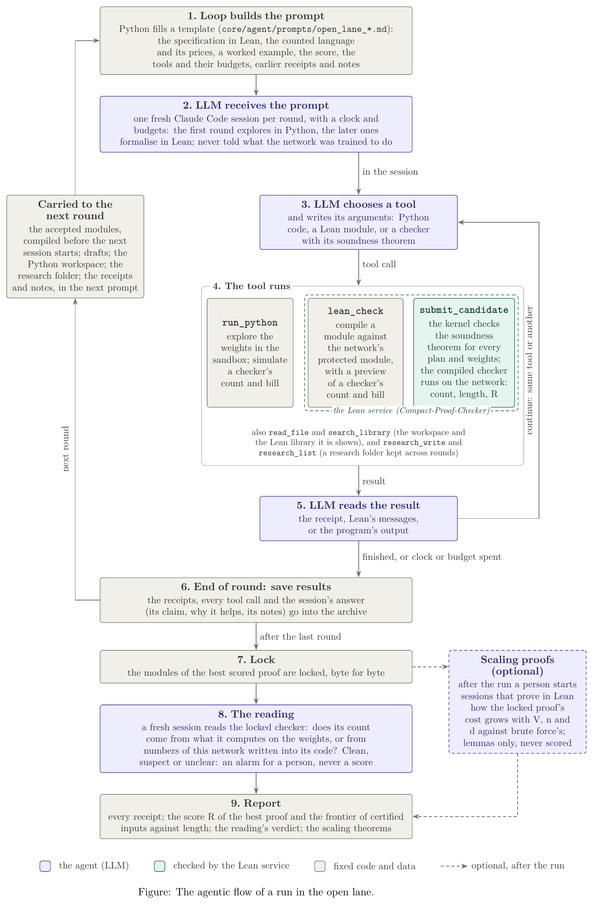

# Compact-Proof-Agent-wip

A pipeline in which an agent hill-climbs towards shorter compact proofs of the accuracy of small trained
networks; in the open lane every proof is checked by Lean. The design is in `docs/SPEC.md` and
`docs/OPEN_LANE.md`.

## Big picture

To be written.

### Pareto Frontier of a compact proof

To be written.

## Reward function

The score of a run is

$$R = \frac{B}{\mathrm{length} + c \cdot (\mathrm{right} - \mathrm{certified})}$$

- B: the cost of brute force, one exact forward pass on every input at the cost rule's prices, plus one per
  weight.
- length: the cost of checking the proof, the operations its checker does on the network's weights, plus one
  per weight and one per number in its certificate. The checker's code and its plan are not charged; their
  size is capped instead.
- c: the cost of brute force on one input, one forward pass.
- right: the number of inputs the network answers correctly; certified: the number of them the proof
  certifies.

R is the value of the run's best proof and never below 1: brute force alone scores 1. A proof counts only if
the Lean service accepts it.

## Agentic setup / Auto-research

## Results

The Lean files, manifests and receipts of the proofs in the tables below are in [`proofs/`](proofs/).

### Experiment 1: Linear

#### Linear max of 4

##### Architecture and training

- Sizes: 64 tokens, 4 slots per input, width 8.
- Weights: three matrices and no biases: an embedding (8 × 64), a hidden matrix (8 × 8) and an unembedding
  (64 × 8). The embedding takes the sum of the four tokens' one-hot vectors, and there is no nonlinearity.
- Task: output the largest of the four tokens.
- Inputs: four tokens, each uniformly random from 0 to 63, drawn fresh at every step.
- Loss and optimiser: cross-entropy with AdamW (learning rate 0.001, betas 0.9 and 0.999, weight decay 0.01),
  batch 1,024, float32.
- Starting weights: uniform in ±1/√k, where k is the number of inputs to the matrix (64 for the embedding, 8
  for the other two).
- Stopping: a fixed 80,000 steps, where the accuracy had levelled off (seed 0 on 200,000 sampled inputs: 99.77%
  at 40,000 steps, 99.81% at 80,000).
- Networks: ten, from seeds 0 to 9, about 3 minutes each. They give the largest token on 99.78% to 99.84% of
  all 64⁴ inputs. The run is on seed 0, which is right on 16,743,886 of the 16,777,216 inputs (99.80%).

##### Price, runtime, agent, internet, inference

- Price: $37.42 for the run (one discovery round, four proof rounds and the reading of the checker), $35.38
  for the six scaling sessions after it.
- Runtime: 2 h 34 min for the run's six sessions, 1 h 29 min for the six scaling sessions. Both include the
  Lean service's checks, which run inside the sessions.
- Agent: Claude Fable 5.1 (`claude-fable-5-1`), thinking effort extra high (Claude Code's `--effort xhigh`).
- Agent tools: `run_python` (runs Python in a sandbox, with the network's weights), `lean_check` (compiles a
  Lean module against the network's protected modules), `read_file` and `search_library` (read the workspace
  and search the Lean library the run offers), `submit_candidate` (hands a checker and its soundness proof to
  the Lean service, which checks and scores it), and in the proof rounds `research_write` and
  `research_list` (a research folder kept across sessions).
- Hyperparameters: money cap $30 a round and $180 a run; 5 rounds (1 discovery, 4 proof) of at most 60
  minutes; per session 60 Lean compiles, 40 Python runs and 4 submissions. The scaling sessions had 30 to 90
  minutes and $10 to $30 each.
- Internet: not used (Claude Code's own tools are switched off, so there are no web tools, and the agent's
  Python runs with the network blocked).
- Inference: not counted (the pipeline does not record how often the agent's Python ran the network).

##### Scores

On seed 0, from the Lean service's receipts. For this network B = 11,257,513,024 and c = 671, and the network
is right on 16,743,886 inputs. The table starts at round 3 because that is the first round in which the agent
submitted an actual compact proof. The previous rounds were used for discovery, "proofs" in Python and general
lemmas in Lean, which were useful for the proofs.

| Proof | Round | Accuracy lower bound | Length (% of brute force) | B / length | R |
| --- | ---: | ---: | ---: | ---: | ---: |
| Brute force (the network itself) | | 99.80% | 100% | 1 | 1 |
| Tree.D | 3 | 94.39% | 0.264% | 379 | 17.6 |
| TreeP.D | 4 | 98.47% | 0.615% | 162 | 51.4 |
| TreeQ.D, locked | 5 | 99.41% | 0.820% | 122 | 82.4 |

##### Evaluation

While we have given the Pareto frontier above, we now want to evaluate the proofs in more detail. We want to
understand in detail what the proofs understood about the structure present in these networks and what they
used. Moreover, we want to distinguish between mere inference optimisation and understanding that is
"mechanistic". Most importantly, we want to compare what the agent handed in as a proof with the best known
proof, which mixes ideas from Louis Jaburi's tutorial notebook
([LouisYRYJ/Proof_based_approach_tutorial](https://github.com/LouisYRYJ/Proof_based_approach_tutorial)) with
ideas of the author, worked out with Claude. There is also a distinction to make between the ideas the agent had,
which we read from the run's records (the notes it kept in its research folder in every round, the candidate
proofs it described there with costs estimated in Python, and the transcripts of its sessions), and the ones the
agent actually submitted in Lean. All the proofs the agent handed in in the 5 rounds are based on the same three
ideas:

**1. Linearity.** The embedding adds up the one-hot vectors of the tokens x = (x₁, x₂, x₃, x₄), and there is no
nonlinearity, so each output's score is a sum of four entries of one 64 × 64 table, computed once:

$$s_j(x) = \sum_{i=1}^{4} M_{j, x_i}, \qquad M = ULE$$

**2. Boxes.** If m is the largest token of x, the network is right when m beats every other answer j, that is,
when every margin is positive. By linearity the margin is a sum of one part per token, with
$D_j(t) = M_{m,t} - M_{j,t}$:

$$\mathrm{margin}_j(x) = s_m(x) - s_j(x) = \sum_{i=1}^{4} D_j(x_i)$$

A box is a set of inputs with largest token m, given by a set of allowed tokens $T_i$ for each position. Since
each part depends on one position only, the smallest margin in the box is the sum of the smallest parts:

$$\min_{x \in \mathrm{box}} \mathrm{margin}_j(x) = \sum_{i=1}^{4} \min_{t \in T_i} D_j(t)$$

If this is positive for all 63 competitors, every input in the box is right, and no input's margin is computed. For
example, with $T_1 = \lbrace 30, 31, 32 \rbrace$, $T_2 = \lbrace 10, 11 \rbrace$, $T_3 = \lbrace 40 \rbrace$ and
$T_4 = \lbrace 5 \rbrace$, the worst case against 43 is −0.14 − 0.76 + 8.03 − 0.70 = 6.43, from the input (32, 10,
40, 5). A box holds the product of its set sizes in inputs, but with each set's minimum stored, its test adds only
four numbers per competitor.

**3. A tree of boxes.** All 16.8 million inputs are split into boxes: by m, by the first position that holds m,
and by ranges of tokens cut finely near m, where the parts change quickly and the network's mistakes are, and
coarsely far below.

The three proofs differ only in where the tree cuts: by a fixed rule (Tree.D), by a list of cuts for each m
(TreeP.D), and by finer lists from a search on the weights (TreeQ.D).

For comparison, three proofs that are not the agent's:

| Proof | Accuracy lower bound | Length (% of brute force) | B / length | R |
| --- | ---: | ---: | ---: | ---: |
| Pure convexity | 71.55% | 0.0051% | 19,620 | 3.5 |
| Convexity, bad tokens fixed | 99.80% | 0.190% | 527 | 527 |
| Best known proof (Ref.D) | 99.80% | 0.0067% | 14,864 | 14,864 |

They use three further ideas:

**4. Convexity.** Let x have largest token m, k copies of it, and other tokens a₁, …, a_r with r = 4 − k. By
linearity its margin is the average of the margins of pure inputs, each made of the k copies of m and r copies of
one token a:

$$\mathrm{margin}_j(x) = \frac{1}{r}\sum_{i=1}^{r} P_j(a_i), \qquad P_j(a) = k \cdot D_j(m) + r \cdot D_j(a)$$

So a token a is good when $P_j(a) > 0$ for every competitor j, and every input whose other tokens are all good is
right. Pure convexity is this alone: about 6,000 pure inputs settle 71.7% of the right inputs, and it misses the
inputs that contain a bad token. Fixing each bad token and testing again covers every right input with convexity
alone, at R 527, 6.4 times the agent's best.

**5. Symmetry.** The scores depend only on how often each token occurs, $c_t(x)$, not on the order:

$$s_j(x) = \sum_{t=0}^{63} c_t(x) \cdot M_{j,t}$$

So one test covers every ordering of an input or a box: the 16.8 million inputs are only 766,480 multisets.

**6. Only neighbours compete.** For given m and k, a competitor j is safe when even its worst case loses:

$$k \cdot D_j(m) + (4-k) \cdot \min_{t \lt m} D_j(t) > 0$$

A safe competitor loses on every input of that class and needs no further test. Here only about 3 of the 63
competitors per m and k are not safe, mostly tokens just above and just below m.

Ref.D combines ideas 1, 2 and 4 to 6, with the bad tokens of convexity fixed and tested again, so that every right
input is covered. Four of its ten Lean modules are the agent's, unchanged.

**What the agent had but did not finish.** Its notes contain ideas 5 and 6, but not 4:

- Symmetry: its round 1 candidates c001 and c002 are boxes of multisets with fewer competitor checks, estimated
  at 0.43 and 3.24 million operations for every right input. It built neither: c001's plan was too large for the
  plan budget, and both need a Lean proof that counts the orderings of a multiset box.
- Only neighbours compete: in round 4 it designed testing each competitor once at the root of a subtree, since
  only about 7 competitors per subtree come close, estimated at 8.6 times fewer operations and R about 200, and
  judged that the soundness proof needs about one session. Round 5 refined the plan instead.
- Convexity: it appears nowhere in its notes, code or session transcripts.

Every session ended early by the agent's choice, and the run used about a fifth of its budget.

### Experiment 2: Attention

#### Attention max of 4

##### Architecture and training

- Sizes: 64 tokens, 4 slots per input, width 32.
- Weights: seven matrices and no biases: a token embedding (64 × 32), a position embedding (4 × 32), the query,
  key and value matrices (32 × 32 each), an output matrix (32 × 32) and an unembedding (32 × 64). One layer with
  one attention head and nothing else: no MLP and no layer norm. The last position attends to all four
  positions, and the output is read there. This is the network of Gross et al.
- Task: output the largest of the four tokens.
- Inputs: four tokens, each uniformly random from 0 to 63, drawn fresh at every step.
- Loss and optimiser: cross-entropy on the output at the last position, with AdamW (learning rate 0.001, betas
  0.9 and 0.999, weight decay 0.01), batch 512, float32.
- Starting weights: uniform in ±1/√k, where k is the matrix's first dimension (64 for the token embedding, 4 for
  the position embedding, 32 for the others).
- Stopping: a fixed 4,000 steps.
- Networks: ten, from seeds 0 to 9, 1 to 2 minutes each. They give the largest token on 99.970% to 99.998% of all
  64⁴ inputs. The run is on seed 0, which is right on 16,775,920 of the 16,777,216 inputs (99.992%); the 1,296
  inputs it gets wrong are exactly those whose tokens are all 5 or less.

##### Price, runtime, agent, internet, inference

- Price: $89.42 for the run (one discovery round, four proof rounds and the reading of the checker), $52.15
  for the seven scaling sessions after it.
- Runtime: 4 h 5 min for the run's six sessions, 2 h 28 min for the seven scaling sessions. Both include the
  Lean service's checks, which run inside the sessions.
- Agent: Claude Fable 5.1 (`claude-fable-5-1`), thinking effort extra high (Claude Code's `--effort xhigh`).
- Agent tools: `run_python` (runs Python in a sandbox, with the network's weights), `lean_check` (compiles a
  Lean module against the network's protected modules), `read_file` and `search_library` (read the workspace
  and search the Lean library the run offers), `submit_candidate` (hands a checker and its soundness proof to
  the Lean service, which checks and scores it), and in the proof rounds `research_write` and
  `research_list` (a research folder kept across sessions).
- Hyperparameters: money cap $40 a round and $200 a run; 5 rounds (1 discovery, 4 proof) of at most 90
  minutes; per session 60 Lean compiles, 40 Python runs and 4 submissions. The scaling sessions had 30 to 90
  minutes and $10 to $30 each.
- Internet: not used (Claude Code's own tools are switched off, so there are no web tools, and the agent's
  Python runs with the network blocked).
- Inference: not counted (the pipeline does not record how often the agent's Python ran the network).

##### Scores

On seed 0, from the Lean service's receipts. For this network B = 220,771,393,664 and c = 13,159, and the network
is right on 16,775,920 inputs. The table starts at round 3 because that is the first round in which the agent
submitted an actual compact proof. The previous rounds were used for discovery, "proofs" in Python and general
lemmas in Lean, which were useful for the proofs. All eight proofs certify every input the network gets right,
so for each of them R = B / length.

| Proof | Round | Accuracy lower bound | Length (% of brute force) | B / length | R |
| --- | ---: | ---: | ---: | ---: | ---: |
| Brute force (the network itself) | | 99.99% | 100% | 1 | 1 |
| Checker.D, window 2 everywhere | 3 | 99.99% | 0.00563% | 17,755 | 17,755 |
| Checker.D, windows from the plan | 3 | 99.99% | 0.00474% | 21,098 | 21,098 |
| Checker2.D | 4 | 99.99% | 0.00387% | 25,845 | 25,845 |
| Checker3.D | 4 | 99.99% | 0.00331% | 30,223 | 30,223 |
| Checker4.D | 4 | 99.99% | 0.00313% | 31,905 | 31,905 |
| Checker5.D | 5 | 99.99% | 0.00305% | 32,820 | 32,820 |
| Checker6.D | 5 | 99.99% | 0.00281% | 35,535 | 35,535 |
| Checker7.D, locked | 5 | 99.99% | 0.00279% | 35,851 | 35,851 |

##### Evaluation

As for the linear network, we compare what the agent handed in with the best known proofs, and we separate the
ideas it had, read from the run's records, from what it submitted in Lean. All eight proofs rest on the same three
ideas, in place from round 3 on:

**1. The three paths.** The output is read at the last position, which attends to all four. As in
[Gross et al.](https://arxiv.org/abs/2406.11779), the score of answer j splits into the direct path of the last
token and, for each position, the OV circuit's value of that position's token, weighted by the attention the QK
circuit gives it:

$$s_j(x) = \mathrm{dir}_j(x_4) + \sum_{i=1}^{4} w_i(x) \cdot \mathrm{OV}_{i, x_i, j}$$

Here the weights $w_i(x)$ are the softmax of the four positions' QK scores for the query $x_4$.

**2. Groups with an exact test.** The inputs are grouped by their last token, their largest token m and the last
position that holds m. Multiplying the lead of m over a competitor j by the softmax denominator $Z(x)$ turns it into
a sum of one term per position, each depending on that position's token alone:

$$Z(x) \cdot (s_m(x) - s_j(x)) = \sum_{i=1}^{4} T_{j,i}(x_i)$$

Since $Z(x)$ is positive, the worst input of a group takes each position's worst token, so the test of a group is
exact, as the box test is for the linear network.

**3. A window near the largest token.** Tokens within $W_m$ of m are handled one by one; smaller tokens share one
bound, from running maxima and minima. The plan gives $W_m$: 2 for ten values of m, 1 for the others.

The proof costs about 2,460 operations for each pair of last token and largest token, over 2,079 pairs, plus about
0.8 million for its tables. The scaling sessions after the run proved in Lean that this cost grows like V³ against
brute force's V⁵, like n² against 64ⁿ, and like d³ against d². The d³ comes from one table product, $W_V W_O$;
multiplying in another order would make it d².

**Understanding and inference optimisation.** The method is already in round 3's proofs; rounds 4 and 5 only made
its arithmetic 1.7 times cheaper. The understanding is the mechanism of Gross et al., which on this network holds
from token 6 up. With $a_q(i, t)$ the attention score of token t at position i for the query q, and
$\mathrm{OV}_{i,t}$ what attending to it adds to the scores, for every q, i and every t ≥ 6:

$$a_q(i, t+1) - a_q(i, t) \ge 0.67$$

$$\mathrm{OV}_{i,t,t} > \max_{j \ne t} \mathrm{OV}_{i,t,j}$$

So the largest token draws the most attention and the head copies it, which is what the window rests on. The
copying fails exactly for the tokens 0 to 5, where all of the network's mistakes are. The locked checker reads every
number from the weights; its only literal is n = 4.

**Against the known proofs.** Gross et al.'s cubic proof uses the same three paths (QK: EQKE, EQKP; OV: EVOU, PVOU;
direct: EU) but rests on convexity: attention weights are nonnegative and sum to 1, so

$$\min_i v_i \le \sum_i w_i(x) \cdot v_i \le \max_i v_i$$

It checks only pure sequences (the largest token, the query and copies of one other token) and bounds every other
input by them, pessimising positions: equal tokens are taken to sit together, and the attention is bounded by two
extreme orderings. On its own networks the paper reports 95.3%.

The agent's proof instead bounds a group $G = S_1 \times \dots \times S_4$ exactly, with each position's own QK and
OV terms:

$$\min_{x \in G} Z(x) \cdot (s_m(x) - s_j(x)) = \sum_{i=1}^{4} \min_{t \in S_i} T_{j,i}(t)$$

It computes this exactly for tokens near m and bounds it for the rest, with nothing pessimised. Both proofs are of
order V³ n², so neither is sub-cubic.

Their sub-cubic proofs avoid the loop over a third token: tokens far enough below the largest one are bounded
together through a gap, and the QK circuit is replaced by a low-rank approximation with an error bound.

| Proof | Accuracy lower bound | Length (% of brute force) | B / length | R |
| --- | ---: | ---: | ---: | ---: |
| Gross et al.'s cubic proof | 97.29% | 0.00255% | 39,256 | 36.9 |
| Gross et al.'s sub-cubic proof | 78.57% | 0.00052% | 193,798 | 4.67 |
| Checker7.D (the agent's) | 99.99% | 0.00279% | 35,851 | 35,851 |

- Cubic: our Lean version of their proof (library entry 7). It certifies as many inputs as their code, is about 9%
  shorter than the agent's proof, and misses 2.7% of the right inputs, so its R is 36.9 against 35,851.
- Sub-cubic: our Lean version (library entry 9) of the best of their 100 configurations, with their step 4 made
  sound (as published it is not sound on 36 of the 100 here). It is about 5.4 times shorter than the agent's proof
  but misses 21% of the right inputs, so its R is 4.67.

**What the agent had but did not finish.** From its notes:

- One far exponential factor per wrong answer over all positions: about 260,000 fewer operations, but the group with
  m = 37 then fails unless its window is 2.
- No exact window for five values of m: about 80,000 fewer.
- A bigger cut, it noted, needs a new idea for the near terms (756 operations per pair) and for the flag sums (570
  per pair), and sharing work across last tokens is blocked because the direct path and the exponential factors
  depend on the last token.

No proof better than the agent's is known for this network, so how far it is from the best is open.
